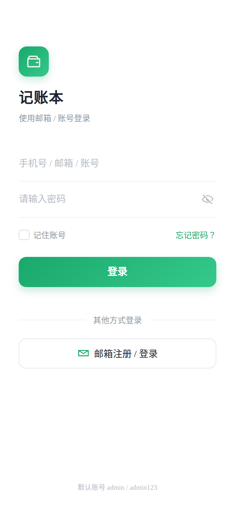
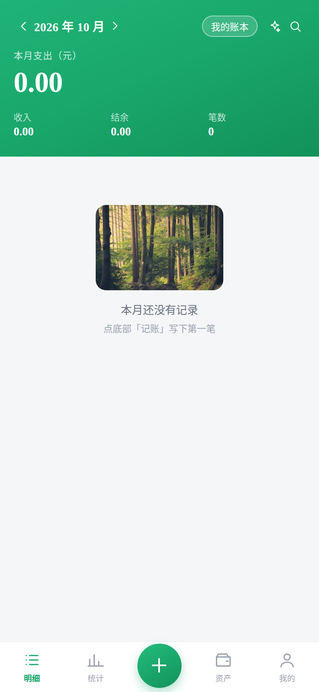
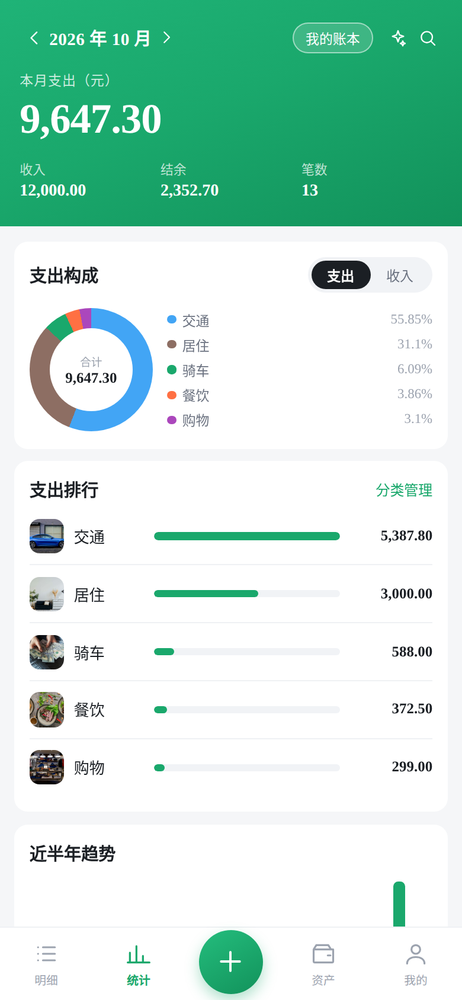
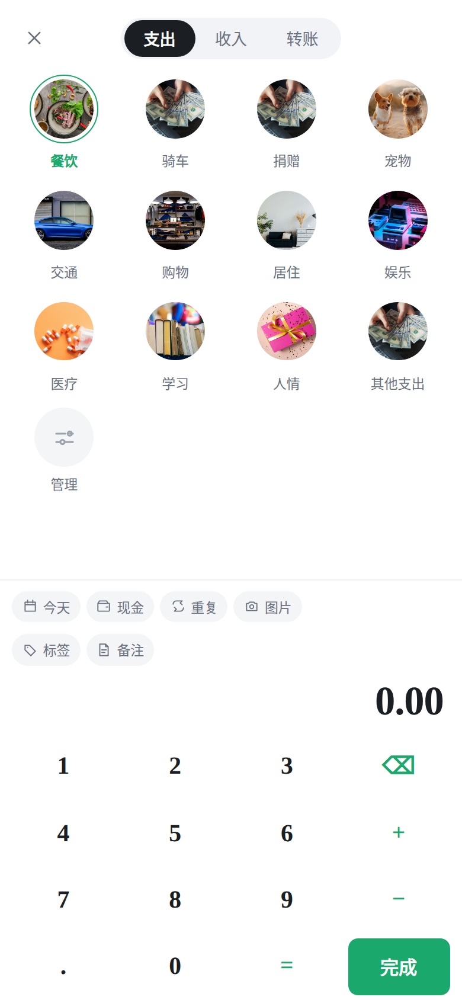

# 记账系统 zbcx-account

一套可私有部署的移动端记账应用：**uni-app (Vue 3) 前端 + RuoYi-FastAPI 后端 + PostgreSQL**。
界面与交互参照市面主流记账 App 重做，覆盖「记一笔 → 分类统计 → 预算 → 资产 → 共享账本」的完整闭环，并支持**邮箱验证码注册**、**邮箱/账号登录**、**AI 对话记账**与**截图 OCR 记账**。

<p align="center">
  
  
  
  
</p>

## 功能一览

| 模块 | 能力 |
| --- | --- |
| 记账 | 支出 / 收入 / 转账三种类型；自绘 4×4 计算键盘（支持 `+ − × ÷` 与 `=`，调度场算法求值，不用 `eval`）；分类九宫格；标签；最多 3 张图片凭证 |
| 明细 | 按日分组、每日小计；点击编辑、长按删除；按月份切换 |
| 统计 | 环形占比 + 分类条形 + 近半年趋势 + 单笔排行（转账不计入收支） |
| 资产 | 多账户（现金/储蓄卡/信用卡/花呗/理财/借入/借出/微信/支付宝/其他），余额由账目实时聚合，不落库；借入类单独计入负债 |
| 预算 | 当月总预算 + 分类预算，进度条按实际支出计算 |
| 搜索 | 分类名 / 标签 / 备注 / 金额四字段联合模糊匹配 |
| AI 记账 | 自然语言「午饭 35 微信」自动解析金额、分类、账户、日期；规则引擎打底，配 `ACCOUNT_LLM_*` 后优先走大模型，失败自动降级 |
| OCR 记账 | 上传支付截图 / 小票，服务端 `tesseract chi_sim+eng` 提取金额与商户，**只做预填**，需用户确认 |
| 周期记账 | 每天 / 每周 / 每月 / 每年；到期**懒执行**补记，`(recurring_id, bill_date)` 幂等去重，单次最多补 60 条 |
| 共享账本 | 多账本隔离，6 位邀请码加入，成员共用同一份收支（账户与分类仍个人级） |
| 认证 | 用户名 / 邮箱登录，密码 BCrypt；注册走**邮箱验证码**（60 秒重发间隔、10 分钟有效），注册成功自动登录 |

未实现：语音记账（需 ASR 服务）、Android 截屏监听（需 MediaProjection 权限，H5 无法调用，已用「上传截图 + OCR」替代）。

## 技术栈

- **前端**：uni-app + Vue 3 + Vite，构建 H5（`npm run build:h5`），移动端 750rpx 适配
- **后端**：FastAPI + SQLAlchemy 2 (async) + PostgreSQL，基于 [RuoYi-FastAPI](https://github.com/flutter-zcj/RuoYi-FastAPI) 扩展
- **缓存**：Redis（令牌、验证码、注册开关热配置）
- **邮件**：`smtplib` + `SMTP_SSL`，HTML + 纯文本双版本正文，在线程池投递不阻塞事件循环

## 目录结构

```
.
├── prjtmpl/                            # 前端（uni-app + Vue3 + Vite）
│   └── src/
│       ├── pages/login/login.vue       # 登录页
│       ├── pages/register/register.vue # 邮箱注册页
│       ├── pages/account/index.vue     # 首页：明细 / 统计 / 资产 / 我的
│       ├── pages/account/add.vue       # 记一笔：类型切换 + 九宫格 + 计算键盘
│       ├── pages/account/account.vue   # 资产账户
│       ├── pages/account/budget.vue    # 预算
│       ├── pages/account/category.vue  # 分类管理
│       ├── pages/account/recurring.vue # 周期记账
│       ├── pages/account/ledger.vue    # 共享账本
│       ├── components/acc-icon/        # SVG 线性图标（CSS mask 着色）
│       └── utils/account/              # 请求封装、接口定义、图片与图标资源
└── RuoYi-FastAPI/ruoyi-fastapi-backend/
    ├── module_account/                 # 记账业务模块（controller/service/dao/entity）
    ├── module_admin/                   # 用户、登录、注册（含邮箱验证码）
    ├── module_identity/                # 统一身份与 OIDC
    ├── utils/mail_util.py              # 验证码邮件投递
    ├── sql/                            # 建库脚本
    └── .env.example                    # 环境配置样例（复制为 .env.dev 后填值）
```

部署细节见 [docs/服务器部署说明.md](docs/服务器部署说明.md)。

## 快速开始

### 后端

```bash
cd RuoYi-FastAPI/ruoyi-fastapi-backend
python -m venv venv && source venv/bin/activate
pip install -r requirements-pg.txt

cp .env.example .env.dev          # 填数据库、Redis、SMTP、JWT 密钥
# 建库后导入平台表与业务表
psql -U postgres -d zbcx_account -f sql/ruoyi-fastapi-pg.sql

python app.py                     # 默认 9100
```

启动时会按配置初始化业务表 `t_acct_*`，首次访问自动写入 16 个默认分类（支出 10 + 收入 6）。

### 前端

```bash
cd prjtmpl
npm install
npm run dev:h5                    # 本地开发
npm run build:h5                  # 产物在 dist/build/h5
```

请求基址与代理在 `src/utils/account/http.js` 和 `vite.config.ts` 中配置，默认指向 `/account-api/`，由 Nginx 反向代理到后端 9100。

### 注册开关

注册受 `sys_config.sys.account.registerUser` 控制。开启需**同时**做三件事，缺一不生效：

```sql
update sys_config set config_value = 'true' where config_key = 'sys.account.registerUser';
```

```bash
redis-cli -n <db> del 'sys_config:sys.account.registerUser'   # 清缓存
systemctl restart zbcx-api                                    # 重启生效
```

## 数据表

| 表 | 说明 |
| --- | --- |
| `t_acct_bill` | 账单（`bill_type` 0 支出 / 1 收入 / 2 转账，逻辑删除 `del_flag`） |
| `t_acct_category` | 分类（`icon` 存 emoji，服务端出口做英文图标名归一化） |
| `t_acct_account` | 资产账户（余额不落库，实时聚合） |
| `t_acct_budget` | 预算（`budget_month` + 可空 `category_id`，为空即当月总预算） |
| `t_acct_recurring` | 周期规则（`rule_type` + `next_run_date`） |
| `t_acct_ledger` / `t_acct_ledger_member` | 账本与成员（`invite_code` 唯一） |

## 安全说明

仓库**不包含**任何密钥：`.env*`、`venv`、`node_modules`、`dist`、日志与上传目录均已排除。
`.env.example` 仅为字段样例，数据库密码、`JWT_SECRET_KEY`、`MAIL_PASSWORD` 等需自行填写。
若不慎在历史提交中泄露，请立即轮换数据库与邮箱客户端密码。

## 许可

MIT。UI 版式仅作学习与参考，图标与照片资源来自 Unsplash，遵循其许可条款。
